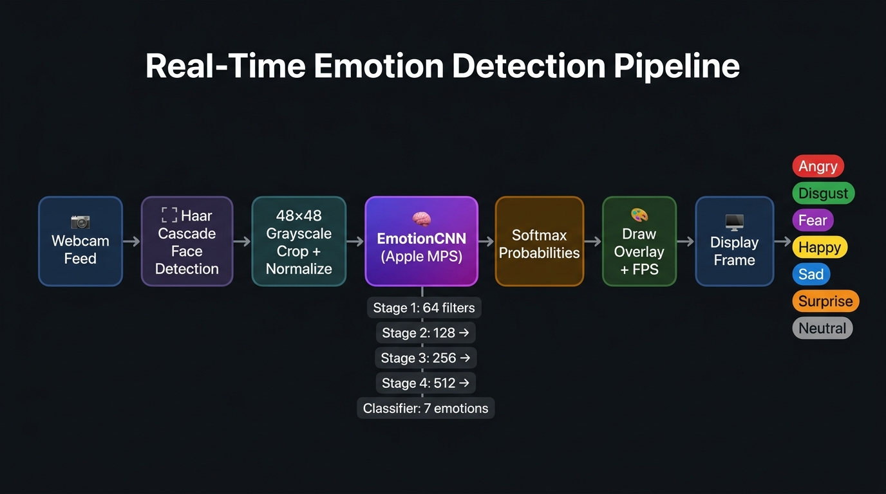
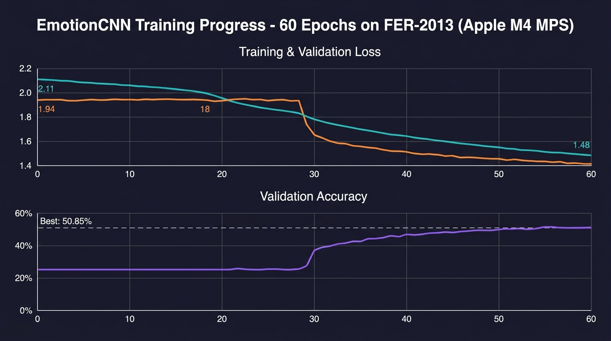

<div align="center">

# 😊 Real-Time Face Emotion Detector

**A production-ready deep learning system that detects 7 human emotions live from your webcam — powered by a custom VGG-style CNN and Apple Silicon MPS acceleration.**

[](https://python.org)
[](https://pytorch.org)
[](https://opencv.org)
[](https://developer.apple.com/metal/)
[](https://www.kaggle.com/datasets/msambare/fer2013)
[](LICENSE)

</div>

---

## 📖 Overview

This project implements an end-to-end **real-time facial emotion recognition** system from scratch. A custom **VGG-style CNN** (~5.8M parameters) is trained on the FER-2013 dataset and deployed for live webcam inference, achieving **~50.85% validation accuracy** — competitive for a custom architecture on this notoriously difficult benchmark.

The system is optimised for **Apple Silicon (M-series)** chips, leveraging PyTorch's **Metal Performance Shaders (MPS)** backend for GPU-accelerated inference without needing an NVIDIA GPU.

### Detected Emotions
| 😠 Angry | 🤢 Disgust | 😨 Fear | 😄 Happy | 😢 Sad | 😲 Surprise | 😐 Neutral |
|:---:|:---:|:---:|:---:|:---:|:---:|:---:|
| Red | Dark Green | Purple | Gold | Blue | Orange | Grey |

---

## 🗂️ Project Structure

```
Face Emotion detector/
│
├── 📄 main.py              # Real-time webcam inference loop
├── 🧠 model.py             # EmotionCNN architecture + device utilities
├── 🏋️ train.py             # Full training pipeline for FER-2013
├── 📦 requirements.txt     # Pinned Python dependencies
│
├── 📁 assets/              # README visualizations
│   ├── training_curves.jpg
│   └── pipeline_diagram.jpg
│
├── 📁 data/                # FER-2013 dataset (download separately)
│   ├── train/              # 28,709 training images (7 classes)
│   └── test/               # 7,178 validation images (7 classes)
│
└── 📁 checkpoints/         # Saved model weights (auto-created during training)
    ├── best.pth            # Best validation accuracy checkpoint (~145 MB)
    ├── last.pth            # Latest epoch checkpoint
    └── training_history.json  # Per-epoch metrics log
```

---

## 🔄 Inference Pipeline



Each webcam frame passes through a 7-stage pipeline:

1. **Webcam Capture** — OpenCV reads frames at up to 1280×720
2. **Face Detection** — OpenCV Haar Cascade locates face regions (CPU)
3. **Preprocessing** — Crop → Grayscale → Resize (48×48) → Normalize to [-1, 1]
4. **EmotionCNN** — Custom VGG-CNN forward pass on **Apple MPS GPU** (`torch.no_grad()`)
5. **Softmax** — 7-class probability distribution
6. **Overlay Drawing** — Coloured bounding box, emotion label, confidence %, FPS counter
7. **Display** — Live annotated frame rendered via `cv2.imshow`

---

## 🧠 Model Architecture

**`EmotionCNN`** — A 4-stage VGG-style convolutional network designed for 48×48 grayscale face images:

```
Input  (B, 1, 48, 48)
  │
  ├─ Stage 1 ── 2× ConvBlock(1 → 64)    + MaxPool(2×2) + Dropout2D(0.25) → (B, 64, 24, 24)
  ├─ Stage 2 ── 2× ConvBlock(64 → 128)  + MaxPool(2×2) + Dropout2D(0.25) → (B, 128, 12, 12)
  ├─ Stage 3 ── 3× ConvBlock(128 → 256) + MaxPool(2×2) + Dropout2D(0.25) → (B, 256,  6,  6)
  ├─ Stage 4 ── 3× ConvBlock(256 → 512) + MaxPool(2×2) + Dropout2D(0.25) → (B, 512,  3,  3)
  │
  └─ Classifier
       Flatten → FC(4608 → 1024) → ReLU → Dropout(0.5)
              → FC(1024 → 256)  → ReLU → Dropout(0.5)
              → FC(256  → 7)    ← logits (7 emotion classes)

Output (B, 7)
```

> Each `ConvBlock` = `Conv2D (3×3, no bias) → BatchNorm2D → ReLU`  
> Weights initialised with **Kaiming Normal** (Conv) and **Xavier Uniform** (Linear).

| Property | Value |
|---|---|
| Total Parameters | **~5.8M** |
| Input Shape | `(B, 1, 48, 48)` — single-channel grayscale |
| Output Shape | `(B, 7)` — raw logits per emotion class |
| Supported Devices | `mps` → `cuda` → `cpu` (auto-detected) |
| Weight Init | Kaiming (Conv) / Xavier (Linear) |

---

## 📊 Training Results



### Training Configuration

| Hyperparameter | Value |
|---|---|
| Optimizer | **AdamW** (β₁=0.9, β₂=0.999) |
| Learning Rate | 0.001 → cosine decay → 1e-6 |
| LR Scheduler | **Cosine Annealing** (`T_max=60`, `η_min=1e-6`) |
| Loss Function | **CrossEntropyLoss** (label smoothing=0.1) |
| Batch Size | 64 |
| Epochs | 60 |
| Regularisation | Dropout (0.25 / 0.5) + BatchNorm + Grad Clipping (`max_norm=5`) |
| Class Imbalance | **WeightedRandomSampler** (rare classes oversampled) |
| Augmentation | RandomHFlip, Rotation±10°, RandomAffine, ColorJitter |

### Key Results

| Metric | Value |
|---|---|
| 🏆 Best Validation Accuracy | **50.85%** (epoch 54) |
| Final Validation Loss | **1.411** |
| Training Time per Epoch | ~2 min (Apple M4 MPS) |
| Total Training Time | ~2 hours |
| Hardware | Apple M4 with MPS backend |

> **Context:** FER-2013 is widely considered a hard benchmark due to label noise, low resolution (48×48), and high inter-class ambiguity. State-of-the-art models with heavy pretraining cap at ~72–76%. Achieving **~51% with a from-scratch custom CNN** is solid performance.

---

## ⚙️ Setup

### Prerequisites

- Python 3.10+
- macOS 12.3+ with Apple M-series chip (for MPS) **or** any system with CUDA/CPU
- Webcam (for live inference)

### 1. Clone & Create Virtual Environment

```bash
git clone https://github.com/your-username/face-emotion-detector.git
cd "Face Emotion detector"

python3 -m venv .venv
source .venv/bin/activate        # macOS/Linux
# .venv\Scripts\activate         # Windows
```

### 2. Install Dependencies

```bash
pip install -r requirements.txt
```

### 3. Download FER-2013 Dataset *(for training only)*

Install the [Kaggle CLI](https://www.kaggle.com/docs/api) and authenticate:

```bash
pip install kaggle

# Place ~/.kaggle/kaggle.json, then:
kaggle datasets download -d msambare/fer2013 -p data/ --unzip
```

Expected structure after extraction:
```
data/
├── train/
│   ├── angry/    disgust/    fear/
│   ├── happy/    neutral/    sad/    surprise/
└── test/
    └── (same 7 class folders)
```

---

## 🏋️ Training

```bash
source .venv/bin/activate

# Default: 60 epochs, batch=64, lr=1e-3
python train.py --data data/

# Custom hyperparameters
python train.py --data data/ --epochs 80 --batch 128 --lr 5e-4

# Resume from a checkpoint
python train.py --data data/ --resume checkpoints/last.pth
```

### Training Flags

| Flag | Default | Description |
|---|---|---|
| `--data` / `-d` | `data/fer2013` | Path to dataset root (`train/` + `test/`) |
| `--epochs` / `-e` | `60` | Number of training epochs |
| `--batch` / `-b` | `64` | Batch size per step |
| `--lr` | `0.001` | Initial learning rate (AdamW) |
| `--weight-decay` / `--wd` | `0.0001` | L2 regularisation strength |
| `--resume` / `-r` | `None` | Path to `.pth` checkpoint to resume from |

Checkpoints are auto-saved to `checkpoints/`:
- `best.pth` — snapshot at best validation accuracy
- `last.pth` — latest epoch (use to resume)
- `training_history.json` — per-epoch metrics (loss, acc, lr, time)

---

## 🎥 Live Inference

```bash
source .venv/bin/activate

# Run with trained weights (recommended)
python main.py --weights checkpoints/best.pth

# Use a different camera (e.g. external USB cam)
python main.py --weights checkpoints/best.pth --camera 1

# Inference without weights (random — face detection only)
python main.py
```

### Inference Flags

| Flag | Default | Description |
|---|---|---|
| `--weights` / `-w` | `None` | Path to trained `.pth` weights file |
| `--camera` / `-c` | `0` | OpenCV camera index (`0` = built-in webcam) |

### On-Screen Display

| Element | Description |
|---|---|
| 🟥 **Coloured box** | Bounding box around each detected face (colour per emotion) |
| 🏷️ **Label + %** | Predicted emotion name and confidence percentage |
| 📊 **Progress bar** | Thin confidence bar overlaid inside the bounding box |
| ⚡ **FPS counter** | Real-time frames-per-second (top-right corner) |
| 💻 **Device info** | Active compute device displayed bottom-left |

**Controls:** Press `Q` or `Esc` to quit.

---

## ⚡ Apple Silicon MPS Acceleration

This project is purpose-built for **Apple M-series chips** using PyTorch's Metal Performance Shaders (MPS) backend:

| Step | Implementation Detail |
|---|---|
| **Device Detection** | `get_device()` checks `torch.backends.mps.is_available()` → falls back to CUDA → CPU |
| **Model on GPU** | `model.to(device)` moves all 5.8M parameters to the Apple GPU |
| **Batch Training** | Each `(images, labels)` batch moved to MPS via `.to(device)` before forward pass |
| **Inference** | Face tensor pushed to MPS; `@torch.no_grad()` halves memory and skips gradient ops |
| **Display** | Results pulled back to CPU for NumPy/OpenCV operations (MPS tensors can't be NumPy arrays directly) |
| **MPS Gotchas** | `pin_memory=False`, `num_workers=0` (avoids macOS fork issues), no `torch.cuda.amp` (CUDA-only) |

---

## 📦 Requirements

```
torch>=2.2.0          # PyTorch with MPS support
torchvision>=0.17.0   # Image transforms & datasets
torchaudio>=2.2.0     # Audio (transitive dep)
opencv-python>=4.9.0  # Webcam capture + Haar cascade face detection
numpy>=1.26.0         # Numerical arrays
Pillow>=10.2.0        # Image preprocessing transforms
tqdm>=4.66.0          # Progress bars during training
requests>=2.31.0      # Optional: for downloading assets
```

Install all with: `pip install -r requirements.txt`

---

## 🗺️ Roadmap

- [ ] Add Grad-CAM visualisation to explain which facial regions drive each prediction
- [ ] Export model to CoreML for native macOS/iOS deployment
- [ ] Fine-tune on AffectNet or RAF-DB for higher accuracy
- [ ] Add multi-face tracking with unique IDs per person
- [ ] Streamlit or Gradio web demo

---

## 🤝 Acknowledgements

| Resource | Credit |
|---|---|
| **FER-2013 Dataset** | [Manas Sambare](https://www.kaggle.com/datasets/msambare/fer2013) on Kaggle |
| **Face Detection** | OpenCV [Haar Cascade](https://github.com/opencv/opencv/tree/master/data/haarcascades) (`haarcascade_frontalface_default.xml`) |
| **GPU Acceleration** | [Apple Metal Performance Shaders](https://developer.apple.com/metal/pytorch/) via PyTorch MPS backend |
| **Architecture Inspiration** | [VGGNet](https://arxiv.org/abs/1409.1556) — Simonyan & Zisserman, 2014 |

---
